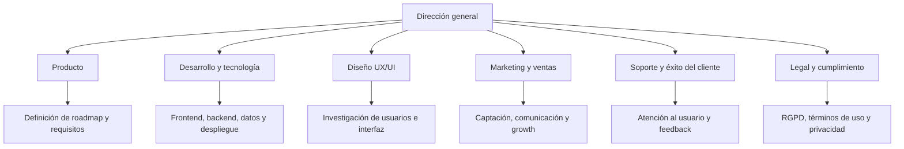

# 01 · Análisis y documentación inicial (RA1)

> **Plantilla.** Se entrega como **H1 el 26-nov-2026**. Cada apartado indica el criterio de evaluación (CE) que evidencia y qué se espera.

> **Nota de elaboración:** Contenido redactado a partir de `00-documentoInicio.md` y de información pública (noviembre 2026). El PDF «Proyecto» indicado por el alumnado no ha podido ser procesado en este entorno; si aporta datos o requisitos adicionales, deben incorporarse.

## 1. Sector y empresas (CE 1a, 1b)

**Sector:** salud digital (mHealth) y bienestar, específicamente aplicaciones web/móviles de nutrición, seguimiento dietético y gestión de macronutrientes.

| Empresa | Características organizativas | Producto o servicio que ofrece |
|---|---|---|
| MyFitnessPal (bajo Under Armour, Inc.) | Gran corporación multinacional del sector deportivo y bienestar digital; estructura compleja con equipos de producto, ingeniería y marketing a escala global | Aplicación/plataforma B2C de registro de alimentos, ejercicio y objetivos calóricos/macros (modelo freemium) |
| Lifesum AB | Empresa tecnológica de tamaño medio, origen sueco, enfocada en producto digital de salud y hábitos | Aplicación B2C de seguimiento nutricional y planes de alimentación/hábitos (modelo freemium con suscripción) |
| YAZIO GmbH | Empresa tecnológica alemana especializada en nutrición digital, orientada a producto propio | Aplicación B2C de contador de calorías, macros, recetas y ayuno intermitente (modelo freemium) |
| Cronometer Software Inc. | Empresa de software de menor tamaño (nicho), centrada en precisión de datos nutricionales | Aplicación/web B2C para seguimiento detallado de macros y micronutrientes (modelo freemium) |
| wger (proyecto comunitario) | Proyecto de software libre mantenido por comunidad de contribuidores; organización distribuida y abierta | Gestor de nutrición y entrenamiento autohospedable y servicio web (gratuito, código abierto AGPL) |

### Empresa tipo: empresa de desarrollo de aplicaciones de nutrición y bienestar (B2C SaaS)

Se describe una **empresa tipo** del sector: una pyme tecnológica que desarrolla y comercializa una aplicación de nutrición como servicio (SaaS) para usuarios finales.

| Departamento | Funciones principales |
|---|---|
| Dirección general | Define la estrategia, objetivos de negocio, presupuesto y coordinación entre áreas |
| Producto | Prioriza funcionalidades, recoge necesidades de usuarios, define el roadmap y valida entregas |
| Desarrollo y tecnología | Diseña, implementa, prueba y mantiene la aplicación (cliente, servidor, base de datos, APIs, infraestructura) |
| Diseño UX/UI | Investiga necesidades de uso, diseña flujos, prototipos e interfaces accesibles y consistentes |
| Marketing y ventas | Da a conocer el producto, gestiona canales de adquisición, fidelización y, en su caso, conversión a planes de pago |
| Soporte y éxito del cliente | Resuelve incidencias, atiende consultas y canaliza sugerencias de mejora al equipo de producto |
| Legal y cumplimiento | Garantiza el cumplimiento normativo (protección de datos, condiciones del servicio) y gestiona aspectos contractuales |

## 2. Necesidades y oportunidades (CE 1c, 1d)

### Necesidades detectadas (lista priorizada)

**Criterio de priorización:** (1) impacto directo en el objetivo del usuario (controlar dieta según metas), (2) frecuencia de la necesidad en el uso cotidiano, (3) viabilidad de implementación en el alcance del TFG.

| Prioridad | Necesidad | Justificación | Fuente |
|---|---|---|---|
| 1 | Calcular de forma orientativa las necesidades calóricas diarias según datos personales y objetivo (subir, mantener o bajar de peso) | Es la base para planificar una dieta coherente con el objetivo | `00-documentoInicio.md`; práctica habitual en apps del sector (ver `01b-sota.md`) |
| 2 | Definir y visualizar objetivos de macronutrientes (proteínas, hidratos, grasas) | Permite traducir calorías a una distribución útil para la planificación | `00-documentoInicio.md`; análisis de soluciones (`01b-sota.md`) |
| 3 | Registrar y gestionar alimentos y recetas propias con sus valores y pesos | Facilita personalización y reutilización en la planificación | `00-documentoInicio.md` |
| 4 | Planificar menús/dietas y comparar totales consumidos/planificados frente a objetivos | Reduce el cálculo manual y los errores de cuadrar macros | `00-documentoInicio.md`; comparación con alternativas manuales (`01b-sota.md`) |
| 5 | Disponer de una interfaz web clara y usable en distintos dispositivos | Mejora la accesibilidad y el uso continuado | `00-documentoInicio.md` (módulos de diseño e interfaces) |

### Oportunidades de negocio / valor

- **Dato cuantitativo (necesidad sanitaria y social):** la Organización Mundial de la Salud señala que, en 2022, 2.500 millones de adultos (18 años o más) tenían sobrepeso, de los cuales 890 millones vivían con obesidad; además, la obesidad mundial en adultos se ha más que duplicado desde 1990. Esto evidencia una necesidad amplia de herramientas de apoyo a hábitos alimentarios saludables. Fuente: OMS, *Obesity and overweight* (actualizado 2025), [https://www.who.int/news-room/fact-sheets/detail/obesity-and-overweight](https://www.who.int/news-room/fact-sheets/detail/obesity-and-overweight) (acceso: 2026-11-19).
- **Oportunidad:** existe demanda de soluciones digitales que ayuden a planificar la alimentación; en el ámbito académico/TFG, la oportunidad se concreta en desarrollar una herramienta sencilla y educativa que automatice cálculos y organización de dietas sin la complejidad de plataformas comerciales. Una eventual explotación comercial requeriría validación adicional (mercado, regulación, protección de datos y diferenciación).

## 3. Tipo de proyecto elegido (CE 1e)

**Tipo de proyecto:** aplicación web de desarrollo a medida (proyecto software) para la formación y gestión de dietas personalizadas, con automatización orientativa de la distribución de calorías y macronutrientes según el objetivo del usuario.

**Justificación:**
- Responde a las necesidades priorizadas (cálculo, definición de macros, gestión de alimentos/recetas y planificación) con un alcance abordable para un TFG individual.
- Frente a alternativas como app móvil nativa, uso exclusivo de hojas de cálculo o adopción de una plataforma existente, la aplicación web permite integrar los módulos de 2.º de DAW (cliente, servidor, diseño de interfaces y despliegue), centralizar datos y ofrecer acceso desde navegador.
- Frente a soluciones comerciales ya maduras, el proyecto aporta valor como ejercicio completo de análisis, diseño e implementación, y como herramienta simple centrada en el flujo de planificación definido en `00-documentoInicio.md`.

## 4. Requisitos y restricciones (CE 1f)

Requisitos redactados de forma verificable, derivados del documento de inicio y del estudio del estado del arte ([`01b-sota.md`](01b-sota.md)).

| ID | Requisito | Tipo (funcional / no funcional / restricción) | Cómo se verifica |
|---|---|---|---|
| RF-01 | El sistema debe permitir registrar y editar un perfil de usuario con, al menos: peso (kg), altura (cm), edad (años), sexo y objetivo (subir, mantener o bajar de peso). | funcional | Prueba funcional: crear/editar perfil y comprobar que los datos se guardan y se muestran correctamente. |
| RF-02 | El sistema debe calcular una estimación de TMB y de gasto energético diario a partir del perfil usando una fórmula documentada en el proyecto (p. ej. Harris-Benedict o Mifflin-St Jeor). | funcional | Caso de prueba con datos de entrada conocidos y comparación del resultado con el valor esperado calculado manualmente (tolerancia de redondeo definida, p. ej. ±1 kcal o ±1%). |
| RF-03 | El sistema debe permitir definir objetivos diarios de calorías y de macronutrientes (proteínas, hidratos de carbono y grasas), expresados en gramos y/o porcentajes. | funcional | Prueba funcional: introducir objetivos, guardar y verificar que la suma/valores se muestran y persisten. |
| RF-04 | El sistema debe permitir crear, consultar, editar y eliminar alimentos con nombre y valores nutricionales por cada 100 g o por porción definida. | funcional | Pruebas CRUD: alta, listado, modificación y borrado con verificación en interfaz y base de datos de pruebas. |
| RF-05 | El sistema debe permitir crear, consultar, editar y eliminar recetas compuestas por uno o más alimentos, indicando cantidad/peso de cada ingrediente. | funcional | Pruebas CRUD y verificación de que los totales nutricionales de la receta se calculan a partir de sus ingredientes. |
| RF-06 | El sistema debe permitir planificar una dieta/menú asignando alimentos y/o recetas y mostrar los totales de calorías y macronutrientes planificados. | funcional | Prueba funcional: crear una planificación y comprobar que los sumatorios coinciden con los valores de los elementos incluidos. |
| RF-07 | El sistema debe mostrar una comparación entre los objetivos del usuario y los totales planificados (calorías y macros). | funcional | Prueba funcional: verificar en pantalla diferencias/restante respecto al objetivo para un caso de prueba. |
| RNF-01 | Las vistas principales de la aplicación deben cargarse en menos de 2 segundos en el entorno de despliegue, medido con conexión de banda ancha doméstica típica. | no funcional | Medición con herramientas del navegador (p. ej. pestaña Network/Lighthouse) en el entorno desplegado; registro de resultados. |
| RNF-02 | Las credenciales de usuario deben almacenarse de forma segura: las contraseñas nunca en texto plano, sino mediante hash seguro (p. ej. bcrypt o algoritmo equivalente). | no funcional | Revisión de implementación y comprobación en la base de datos de pruebas de que no se almacena la contraseña en claro. |
| RNF-03 | La interfaz debe ser responsive y usable en anchos de pantalla de 360 px (móvil) y 1280 px (escritorio) sin pérdida de funcionalidad principal. | no funcional | Pruebas de interfaz/redimensionado o emulación en navegador verificando acceso a las funciones RF-01 a RF-07. |
| RNF-04 | El código fuente del proyecto debe gestionarse en un repositorio Git con historial de cambios. | no funcional | Verificación de la existencia del repositorio y del historial de commits. |
| REST-01 | El proyecto debe desarrollarse y entregarse conforme al calendario del módulo/proyecto intermodular de DAW 2026-27. | restricción | Revisión del cumplimiento de hitos y entregas planificadas. |
| REST-02 | No se utilizarán datos personales reales; el sistema se probará y demostrará con datos ficticios o de ejemplo. | restricción | Revisión de los datos cargados en demostraciones, capturas y base de datos de pruebas. |
| REST-03 | El proyecto debe integrar contenidos reales de al menos tres módulos de 2.º de DAW (cliente, servidor, despliegue y diseño de interfaces). | restricción | Evidencias en la memoria y el repositorio (código, diseño, despliegue y documentación). |

### Matriz de trazabilidad

En H1 se relacionan objetivos y requisitos; el resto de columnas se completarán en fases posteriores.

| Objetivo | Requisito | Caso de uso | Pantalla o endpoint | Prueba o indicador |
|---|---|---|---|---|
| OBJ-01 Gestionar el perfil y el objetivo nutricional del usuario | RF-01, RF-02, RF-03 | Pendiente | Pendiente | Pendiente |
| OBJ-02 Gestionar alimentos y recetas propios | RF-04, RF-05 | Pendiente | Pendiente | Pendiente |
| OBJ-03 Planificar dietas y comparar con objetivos | RF-06, RF-07 | Pendiente | Pendiente | Pendiente |
| OBJ-04 Garantizar una solución usable, segura y desplegable | RNF-01, RNF-02, RNF-03, RNF-04 | Pendiente | Pendiente | Pendiente |
| OBJ-05 Cumplir las condiciones académicas y de alcance del TFG | REST-01, REST-02, REST-03 | N/A | N/A | Pendiente |

## 5. Obligaciones fiscales, laborales y de prevención (CE 1g)

ProyectoNacho es un **proyecto académico** (TFG de DAW), desarrollado por un alumno sin actividad económica ni relación laboral derivada del propio proyecto. En su estado actual no genera facturación, contratación ni prestación de servicios a terceros, por lo que **no le son aplicables de forma directa** obligaciones fiscales, laborales ni de prevención de riesgos como actividad empresarial. No obstante, se identifican las obligaciones y normas que serían relevantes si el proyecto se publicara o explotara en el futuro:

| Ámbito | Norma | Condiciones de aplicación al proyecto |
|---|---|---|
| Protección de datos personales | Reglamento (UE) 2016/679 (RGPD) y Ley Orgánica 3/2018, de 5 de diciembre (LOPDGDD) | Aplicaría si se tratasen datos personales reales de usuarios (registro, datos de salud/nutrición, etc.). Actualmente se evita usando solo datos de prueba (REST-02); en una puesta en producción sería necesario informar, obtener base legitimadora, aplicar medidas de seguridad y respetar derechos. |
| Servicios de la sociedad de la información y comercio electrónico | Ley 34/2002, de 11 de julio (LSSI-CE) | Aplicaría si la web prestara servicios de la sociedad de la información con carácter económico/profesional (información legal, condiciones de uso, comunicaciones comerciales, cookies según normativa aplicable). No aplica en la fase académica sin explotación. |
| Obligaciones fiscales (IRPF/IVA/Impuesto sobre Sociedades) | Ley 35/2006 (IRPF), Ley 37/1992 (IVA), Ley 27/2014 (IS), según actividad | Aplicarían solo si existiera actividad económica (venta, suscripciones, publicidad, etc.). En el TFG no hay ingresos ni actividad empresarial. |
| Obligaciones laborales y Seguridad Social | Real Decreto Legislativo 2/2015 (Estatuto de los Trabajadores) y Real Decreto Legislativo 8/2015 (LGSS) | Aplicarían en caso de contratación de personal para desarrollar o explotar el producto. No procede en el desarrollo individual académico. |
| Prevención de riesgos laborales | Ley 31/1995, de 8 de noviembre, de Prevención de Riesgos Laborales | Aplicaría en el ámbito de una relación laboral/empresa con trabajadores. En el contexto académico, se observan medidas básicas de ergonomía y salud en el trabajo con equipos informáticos, sin constituir un sistema formal de PRL empresarial. |
| Propiedad intelectual y licencias de software | Real Decreto Legislativo 1/1996 (Ley de Propiedad Intelectual) y licencias de terceros | Aplica al uso de librerías, frameworks, imágenes y contenidos: respetar licencias (MIT, Apache, GPL, etc.) y atribuciones requeridas. |

## 6. Ayudas y subvenciones (CE 1h)

Ayuda real identificada (aplicable en caso de que el proyecto evolucionara hacia una iniciativa emprendedora/empresa):

| Concepto | Detalle |
|---|---|
| Ayuda / instrumento | **ENISA – Línea de Préstamos Participativos para Jóvenes Emprendedores** |
| Fuente | Empresa Nacional de Innovación, S.M.E., S.A. (ENISA): [https://www.enisa.es/es/financiacion/lineas-de-financiacion/d/jovenes-emprendedores](https://www.enisa.es/es/financiacion/lineas-de-financiacion/d/jovenes-emprendedores) (acceso: 2026-11-19) |
| Objeto | Financiación participativa para apoyar proyectos empresariales viables e innovadores impulsados por emprendedores jóvenes, contribuyendo al inicio/primer desarrollo de la empresa |
| Requisitos principales (resumen, verificar en la convocatoria vigente) | Sociedad mercantil de pequeña dimensión con el proyecto liderado por jóvenes emprendedores (según condiciones de edad/participación establecidas por ENISA), modelo de negocio viable, cofinanciación junto a aportación de socios y cumplimiento de condiciones financieras y de elegibilidad publicadas por ENISA |
| Importe (orientativo, según condiciones publicadas) | Préstamos participativos de importe variable según tramo y evaluación (consultar límites y condiciones vigentes en la web oficial) |
| Plazo | Solicitud sujeta a disponibilidad y a las condiciones de la línea en el momento de la petición; consultar estado, procedimiento y plazos actualizados en la web oficial de ENISA (acceso: 2026-11-19) |

> **Nota:** esta ayuda no se solicita en el marco del TFG actual, ya que el proyecto no está constituido como empresa; se recoge como ayuda real potencial para una fase posterior de emprendimiento.

## 7. Guion de trabajo (CE 1i)

Plan de trabajo preliminar (responsable principal: alumno Nacho, salvo revisión/tutorización docente). El seguimiento detallado puede apoyarse en el tablero de GitHub Projects del repositorio.

| Fase | Periodo orientativo | Hitos / entregables | Responsable | Estado |
|---|---|---|---|---|
| Inicio y definición | 6-nov-2026 a 12-nov-2026 | `00-documentoInicio.md` cumplimentado y aprobado por el tutor | Alumno / Tutor | Completado / en revisión según tutoría |
| Análisis y estado del arte (H1) | 13-nov-2026 a 26-nov-2026 | `01-analisis.md` y `01b-sota.md` (versión H1) | Alumno | En curso |
| Diseño (arquitectura, modelo de datos, UI) | Dic-2026 a Ene-2027 | Bocetos/wireframes, modelo E-R, definición de API y decisiones técnicas | Alumno | Pendiente |
| Implementación del backend y base de datos | Ene-2027 a Mar-2027 | API, lógica de cálculo de macros, persistencia y autenticación básica | Alumno | Pendiente |
| Implementación del frontend | Feb-2027 a Abr-2027 | Interfaces responsive, formularios, vistas de planificación y comparación de objetivos | Alumno | Pendiente |
| Pruebas, despliegue y documentación (H2/H3) | Abr-2027 a Jun-2027 | Pruebas funcionales, correcciones, despliegue, memoria y evidencias finales | Alumno / Tutor | Pendiente |
| Defensa / cierre | Según calendario oficial 2026-27 | Presentación y entrega final | Alumno | Pendiente |

## 8. Glosario

| Término | Definición | Sinónimos que NO uso |
|---|---|---|
| TMB (Tasa Metabólica Basal) | Estimación de la energía que el cuerpo necesita en reposo para mantener funciones vitales, calculada a partir de datos como edad, sexo, peso y altura mediante fórmulas (p. ej. Harris-Benedict o Mifflin-St Jeor). | "Metabolismo" (genérico), "calorías en reposo" sin precisar |
| GET / Gasto Energético Total | Estimación de las calorías diarias totales considerando la TMB y el nivel de actividad física/objetivo. | "Calorías que quemo" (ambiguo), "TDEE" sin traducir en el texto principal |
| Macronutriente | Nutriente que aporta energía y se consume en cantidades relevantes: proteínas, hidratos de carbono y grasas; en el proyecto se expresa en gramos y/o porcentaje sobre el objetivo calórico. | "Macro" (como único término formal), "nutriente" en sentido amplio |
| Alimento | Elemento individual registrado en el sistema con información nutricional (calorías y macronutrientes) asociada a una cantidad o porción. | "Producto", "ingrediente" (reservado al contexto de receta) |
| Receta | Conjunto de alimentos con cantidades/pesos definidos que se agrupan como una preparación; el sistema calcula sus valores nutricionales totales. | "Plato" (informal), "menú" (reservado para planificación) |
| Dieta / Planificación | Organización de alimentos y/o recetas en un periodo o ingesta con el fin de alcanzar unos objetivos de calorías y macronutrientes. | "Régimen", "meal plan" sin traducir |
| Objetivo nutricional | Meta definida por el usuario (subir, mantener o bajar de peso) junto con sus objetivos de calorías y distribución de macronutrientes. | "Meta" (genérico), "target" sin traducir |

---

## Criterios de evaluación de este documento (RA1, texto literal)

- **1a)** Se han clasificado las empresas del sector por sus características organizativas y el tipo de producto o servicio que ofrecen.
- **1b)** Se han caracterizado las empresas tipo indicando la estructura organizativa y las funciones de cada departamento.
- **1c)** Se han identificado las necesidades más demandadas a las empresas.
- **1d)** Se han valorado las oportunidades de negocio previsibles en el sector.
- **1e)** Se ha identificado el tipo de proyecto requerido para dar respuesta a las demandas previstas.
- **1f)** Se han determinado las características específicas requeridas al proyecto.
- **1g)** Se han determinado las obligaciones fiscales, laborales y de prevención de riesgos y sus condiciones de aplicación.
- **1h)** Se han identificado posibles ayudas o subvenciones para la incorporación de nuevas tecnologías de producción o de servicio que se proponen.
- **1i)** Se ha elaborado el guión de trabajo que se va a seguir para la elaboración del proyecto.
